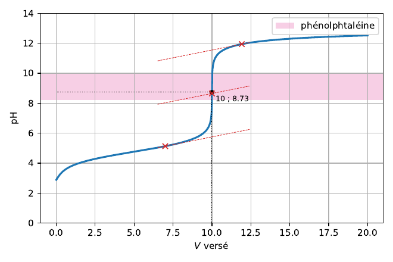
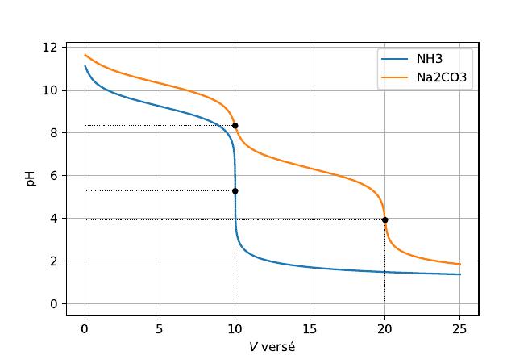
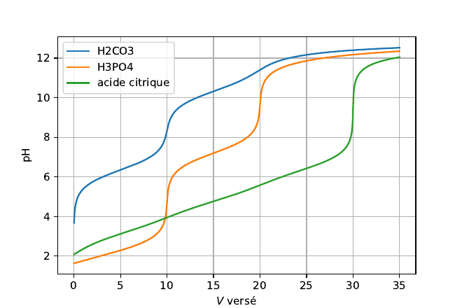
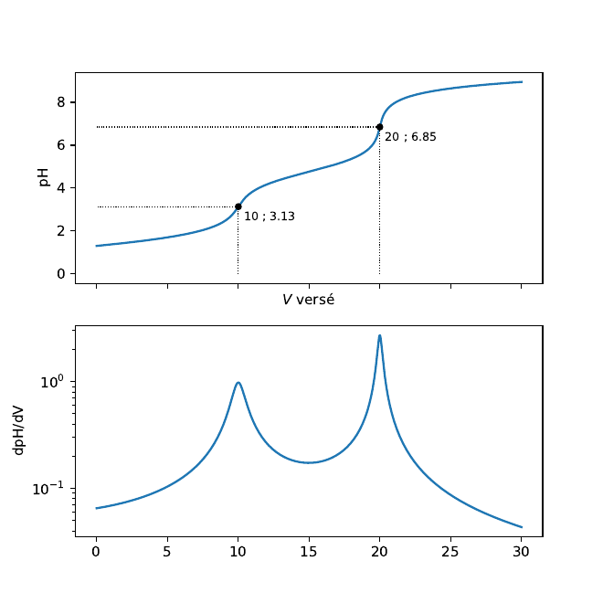
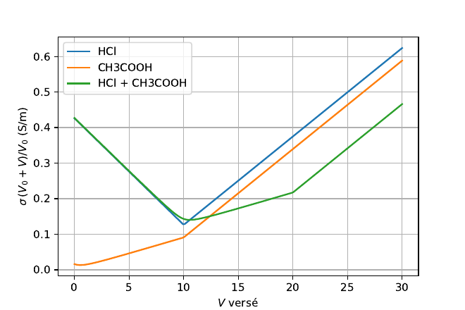
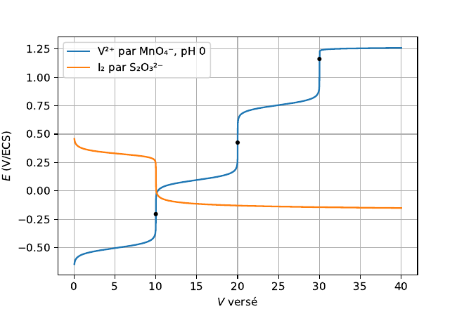
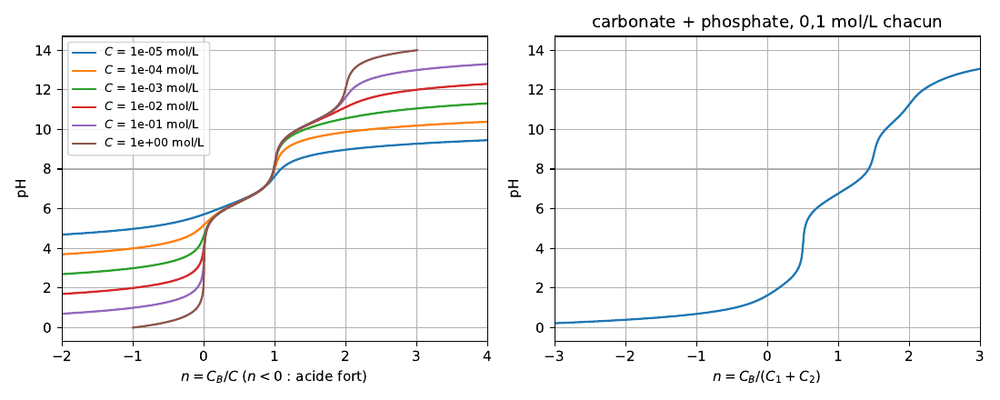

# Galerie des exemples

Chaque script de ce dossier calcule ses courbes avec `titrages`, les affiche et
enregistre sa figure en PDF à côté de lui ; les images ci-dessous en sont la version
PNG, groupées par thème : les titrages pH-métriques d'un acide ou d'une base, puis des
polyacides et des mélanges, la conductimétrie, la potentiométrie, les fractions et le
pH d'une solution, enfin l'export vers pgfplots. Les scripts se lancent depuis la
racine du dépôt, matplotlib installé (`uv sync`, ou `pip install "titrages[trace]"`) :

```bash
uv run python examples/01_acide_faible.py
```

## Acides et bases, forts et faibles

### Un acide faible par une base forte — [`01_acide_faible.py`](01_acide_faible.py)

L'acide éthanoïque 0,1 mol/L titré par la soude 0,1 mol/L, 10 mL dans le bécher : le
pH part de 2,9, vaut pKa = 4,76 à la demi-équivalence, et saute à l'équivalence (10 mL,
pH 8,73), basique puisque l'éthanoate est une base faible. `Titrage`, construit sur
deux `solution`, donne la courbe à `tracer_titrage` ; `tracer_sauts` marque le point
d'inflexion, `tracer_tangentes` construit la méthode des tangentes parallèles depuis
7 mL (`t.tangentes(7, 20)` rend 10,000 mL), et `tracer_zone_virage` colore la zone de
virage de la phénolphtaléine, prise dans la base par `indicateur`, qui encadre bien le
saut.



### Un acide fort par une base forte — [`09_titrage_acide_fort.py`](09_titrage_acide_fort.py)

L'acide chlorhydrique 0,1 mol/L par la soude 0,4 mol/L. À gauche, en abscisse réduite
n = V/V_éq (`tracer_titrage(..., abscisse=Veq)`), la courbe exacte, la courbe sans
dilution (`Titrage(..., dilution=False)`) et, en tirets, les formules approchées
classiques, pH = pC_B + p((1 − n)/(y + n)) avant l'équivalence et
pH = pK_e − pC_B − p((n − 1)/(y + n)) après, avec y = C_B/C_A : elles coïncident avec
le calcul exact. À droite, la méthode des tangentes construite pour quatorze points de
départ : le volume trouvé est exact à 10⁻⁶ près, mais le pH du point construit s'écarte
de 7 d'autant plus que la pente choisie est faible, parce que la dilution dissymétrise
la courbe dès que y ≠ 1.


### Une base faible et une dibase par un acide fort — [`10_titrage_base_faible.py`](10_titrage_base_faible.py)

L'ammoniac et le carbonate de sodium, 0,1 mol/L, par l'acide chlorhydrique 0,1 mol/L :
une base faible n'est que la forme basique d'un couple, NH₃ la forme 1 de NH₄⁺/NH₃,
CO₃²⁻ la forme 2 de H₂CO₃, et `solution({"Na2CO3": 0.1})` ajoute les deux Na⁺
spectateurs. Les courbes descendent : un saut à 10 mL pour l'ammoniac (pH 5,28, acide
puisque NH₄⁺ est un acide faible), deux pour le carbonate (10 mL à pH 8,34, celui de
l'ampholyte HCO₃⁻, et 20 mL à pH 3,92). Le pH à la première demi-équivalence vaut le
pKa : 9,25 et 10,32. `tracer_sauts(..., texte=False)` pose les points sans leurs
coordonnées.



## Polyacides et mélanges

### Trois polyacides — [`02_polyacides.py`](02_polyacides.py)

L'acide carbonique, l'acide phosphorique et l'acide citrique, 0,1 mol/L, par la soude
0,1 mol/L : `volumes_equivalents` compte les équivalences stœchiométriques, `sauts` les
points d'inflexion effectivement présents sur la courbe, et les deux ne coïncident
pas. L'acide phosphorique a trois équivalences et deux sauts (pKa₃ = 12,35 est hors de
portée de la soude) ; le second saut de l'acide carbonique est décalé à 19,7 mL et à
peine marqué ; l'acide citrique, dont les trois pKa se suivent de près (3,13, 4,76,
6,4), ne montre qu'un saut net, au troisième équivalent, les deux premières inflexions
étant presque invisibles.

```text
H2CO3           équivalences (10.0, 20.0)  sauts [10.0, 19.7]
H3PO4           équivalences (10.0, 20.0, 30.0)  sauts [10.0, 20.0]
acide citrique  équivalences (10.0, 20.0, 30.0)  sauts [9.95, 20.08, 30.0]
```



### Un diacide : dilution, demi-équivalences, tangentes — [`11_titrage_diacide.py`](11_titrage_diacide.py)

Un diacide de pKa 4 et 10, défini par `Couple.polyacide(4, 10)`, titré par la soude
0,1 mol/L à trois concentrations. À gauche, en abscisse réduite, la courbe exacte en
trait plein et la courbe sans dilution en tirets, qui s'en écarte après la seconde
équivalence, d'autant plus que le bécher est concentré ; les segments horizontaux
relèvent le pH à chaque demi-équivalence : pKa₁ à n = 1/2, (pKa₁ + pKa₂)/2 = 7 à n = 1,
pKa₂ à n = 3/2. La méthode des tangentes (`t.tangentes`) rend exactement n = 1 et pH 7
au premier saut ; au second, trop faible (pKa₂ = 10), elle s'arrête entre n = 1,93 et
1,97. À droite, la pente analytique `Courbe.pente` sert à dessiner un petit segment
tangent en chaque point de la courbe à 0,1 mol/L, et `tracer_tangentes` y construit la
méthode depuis 6 mL.

```text
C = 0.01, n = 1 : tangentes, n = 1.0000, pH = 7.000
C = 0.01, n = 2 : tangentes, n = 1.9279, pH = 10.776
C = 0.1, n = 1 : tangentes, n = 1.0000, pH = 7.000
C = 0.1, n = 2 : tangentes, n = 1.9684, pH = 11.119
```


### Un mélange d'acides par un titrant faible — [`03_melange_titrant_faible.py`](03_melange_titrant_faible.py)

L'acide chlorhydrique et l'acide éthanoïque, 0,05 mol/L chacun dans 20 mL, titrés par
l'ammoniac 0,1 mol/L : la burette est une base faible, le calcul ne change pas. L'acide
fort est titré d'abord (saut à 10 mL, pH 3,13), puis l'acide faible (20 mL, pH 6,85),
et au-delà le pH plafonne vers 9, celui d'un tampon NH₄⁺/NH₃, et non d'un excès de
soude. En bas, `tracer_derivee` trace dpH/dV en échelle logarithmique : les deux pics,
d'inégale hauteur, sont les deux sauts que `tracer_sauts` a marqués en haut.



## Conductimétrie

### Acide fort, acide faible et leur mélange — [`05_conductimetrie.py`](05_conductimetrie.py)

L'acide chlorhydrique, l'acide éthanoïque, puis leur mélange, 0,01 mol/L dans 100 mL,
par la soude 0,1 mol/L : `tracer_conductimetrie(..., corrigee=True)` trace la
conductivité corrigée de la dilution, σ(V₀ + V)/V₀, en S/m, par la loi de Kohlrausch
avec les ions spectateurs (le Na⁺ de la soude). Pour l'acide fort, σ décroît tant que
H₃O⁺, très mobile, est remplacé par Na⁺, puis croît avec l'excès de HO⁻ ; pour l'acide
faible, elle croît faiblement (éthanoate et Na⁺ apparaissent) puis plus vite ; le
mélange enchaîne les trois pentes, avec une cassure à chaque équivalence, 10 et 20 mL.
Corrigées de la dilution, les courbes sont des segments de droite, comme le veut la
méthode ; `t.courbe_conductimetrique` donne les mêmes points sans les tracer.



## Potentiométrie

### Le vanadium par le permanganate, et l'iodométrie — [`06_redox.py`](06_redox.py)

Deux titrages rédox avec `TitrageRedox` et `solution_redox`, le potentiel mesuré contre
l'électrode au calomel saturé (`"ECS"`). Le vanadium(II) 0,1 mol/L par le permanganate
0,02 mol/L, à pH 0, est oxydé en trois étapes, V²⁺ → V³⁺ → VO²⁺ → VO₂⁺ : trois
équivalences à 10, 20 et 30 mL, et trois sauts, à −0,20, 0,43 et 1,16 V, que
`tracer_titrage_redox(..., sauts=True)` marque. Le diiode 0,05 mol/L par le
thiosulfate 0,1 mol/L met en jeu deux couples dimériques, I₂/I⁻ et S₄O₆²⁻/S₂O₃²⁻ : la
courbe descend, le titrant étant réducteur, avec un saut à 10 mL.

```text
vanadium : (10.0, 20.0, 30.0) [-0.204, 0.426, 1.163]
iodométrie : (10.0,)
```



## Fractions et pH d'une solution

### Diagramme de distribution, et pH = f(pC) — [`07_fractions_et_pC.py`](07_fractions_et_pC.py)

À gauche, `tracer_fractions` dessine les fractions de H₂CO₃, HCO₃⁻ et CO₃²⁻ en fonction
du pH pour un `Couple` défini par ses pKa (6,3 et 10,3) : deux courbes voisines se
croisent à un pKa, et l'ampholyte HCO₃⁻ domine entre les deux. À droite, le pH d'un
monoacide de pKa 4 seul en solution, en fonction de pC = −log C, calculé dans les deux
sens : `concentration_pour_pH` donne C(pH) directement, `Solution().avec(acide, C).pH()`
retrouve pH(C) par dichotomie, et les croix tombent sur la courbe. Les asymptotes sont
celles des réactions prépondérantes : pH = ½(pKa + pC) en solution concentrée, pH = pC
quand l'acide est entièrement dissocié, pH → 7 quand il est trop dilué pour compter.


### Acide ou base forts ajoutés sans dilution — [`08_melanges_sans_dilution.py`](08_melanges_sans_dilution.py)

`Solution.residu(pH)` est le résidu de l'électroneutralité d'une solution : divisé par
la concentration C de l'acide, c'est le nombre n de bases fortes par acide qu'il faut
lui ajouter, sans dilution, pour atteindre ce pH, négatif quand c'est un acide fort
qu'on ajoute. À gauche, H₂CO₃ de 10⁻⁵ à 1 mol/L : les sauts à n = 1 et n = 2
s'affirment avec la concentration, et toutes les courbes passent par pH = pKa à n = 1/2
et n = 3/2 dès que C est assez grande. À droite, un mélange équimolaire de carbonate et
de phosphate, 0,1 mol/L chacun, de n = −3 à 3. Le script vérifie ensuite avec
`Titrage(..., dilution=False)` que le pH à n = 1/2 et n = 1 vaut 6,35 et 8,34.



## Export vers pgfplots

### Les coordonnées d'une courbe pour pgfplots — [`04_pgfplots.py`](04_pgfplots.py)

Pas de figure ici : le carbonate de sodium 0,05 mol/L par l'acide chlorhydrique
0,1 mol/L est calculé par `t.courbe(25, 150)`, 150 points jusqu'à 25 mL, et
`vers_pgfplots` les écrit sous la forme qu'attend `\addplot coordinates`, à coller dans
un `.tex`. La courbe elle-même, celle d'une dibase, est celle de
[`10_titrage_base_faible.py`](10_titrage_base_faible.py) ; le paquet LaTeX `titrages`
sait aussi la calculer directement, sans passer par Python.

```text
\addplot coordinates {(0,11.5) (0.18506,11.433) (0.37119,11.365) … (24.749,1.9741) (25,1.9542)};
```

## Licence

Ces exemples et leurs courbes sont sous licence Creative Commons Attribution - Pas
d'utilisation commerciale - Partage dans les mêmes conditions 4.0 International,
CC BY-NC-SA 4.0 (`LICENSE-CC-BY-NC-SA-4.0` à la racine du dépôt) ; le paquet est sous
licence MIT.
